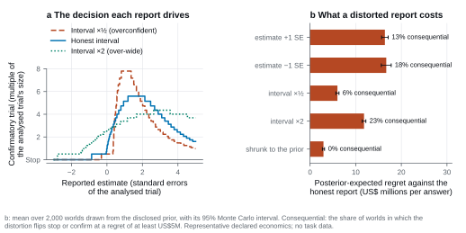

# TrialAgentBench

An AI agent can analyse a clinical trial competently by every surface check and still drive the
wrong development decision, either because the trial's default analysis fails on its data or because
the agent corrects a problem the data do not have. TrialAgentBench measures whether agents recover
the decision-relevant treatment effect from realistic trial records and commission evidence worth
its cost under a budget. It prices each error by the development decision it changes, in simulated
worlds whose true effects are known.

This repository holds the harness that runs agents on the benchmark, the independent verifier that
re-scores them, and the documentation. The task data are on
[Hugging Face](https://huggingface.co/datasets/TrialAgentBench/TrialAgentBench).

## What it measures and why



*How an answer is priced: each reported estimate and interval drives a decision to stop or to run a
confirmatory trial of a chosen size (left), and every distortion of an honest report, from a shifted
estimate to the agent's own shrinkage towards the prior, costs expected value against it (right).*

| Benchmark | The agent's work | The score |
| --- | --- | --- |
| **TrialEval** | Analyse a completed randomised trial from its protocol and participant-level records, in Python or R | Expected US$ millions lost when the answer leads to a different development decision (stop, or confirm at a chosen size) from an analysis verified to recover the true effect (posterior-expected regret); numerical loss is secondary |
| **TrialDev** | Analyse observational evidence on several candidate treatments, commission randomised studies under a budget and a six-year horizon, then stop or advance | Risk-adjusted development value, compared with stopping at once and with an oracle that knows every true effect |

Three design choices make a score mean what it claims. The reference answers are the true effects
of the simulated worlds, so no method is privileged: the benchmark accepts (credits) analyses shown
to recover the true effect that respect the trial's design and do not discard so much of the
information it provides that they cost decision value, and a credited analysis costs nothing. Some
trials are **traps**: the usual analysis fails on their data and changes the decision. Others are
**twins**: their data show a departure that tempts the same kind of fix, but the usual analysis is
valid, and the fix, though unbiased, wastes information and costs decision value. Each trap is
paired with a benign trial of its series (one clinical question and trial design), usually a twin,
whose documents are identical, so reading
the protocol cannot tell trap from twin, and an agent that always applies the fix loses in the
twins. Finally, each error is priced by the decision it changes, so a numerically close answer that
changes stop or confirm, or only the size of the confirmatory trial, is penalised, and an answer that
leads to the same decision as a credited analysis is not.

The public split is for development and self-reported results: its evaluator files are public, and
its task counts show which series hold a trap and its counterpart. Leaderboard claims use the
withheld split, which the operator holds and in which a trap and its counterpart never share worlds.

Scores describe performance in simulated populations. They do not measure clinical effectiveness,
patient-care competence or regulatory fitness. [METHODS.md](docs/METHODS.md) sets out the
construction, grading, construct-validity argument and limitations.

## Quickstart

With Python 3.11 or 3.12, [uv](https://docs.astral.sh/uv/) and Docker running, install the locked
environment and run the bundled clinical demonstration:

```bash
git clone https://github.com/TrialAgentBench/TrialAgentBench-harness
cd TrialAgentBench-harness
uv sync --locked
docker build --tag trialagentbench/executor:1.0.0 executor
uv run trialagentbench demo run --output results/demo
```

Installation and the first container build need network access. The demo then runs offline, with
no benchmark download, provider extra or credential. Open `results/demo/index.html` to inspect
estimates, intervals, replayed code and development consequences. It uses a scripted analyst;
its scores measure no model. Use a new output directory for a fresh run, or add `--resume`.

Continue with [RUNNING.md](docs/RUNNING.md) to download and verify the dataset and run the
three-task smoke campaign. The headline main selection is 852 tasks per model and repetition
(84 TrialEval, 768 TrialDev). The guide covers model configuration, spending limits, task selections,
resuming, recovery and results; [METHODS.md](docs/METHODS.md) then explains the scores, and the
[verifier guide](verifier/README.md) explains independent reproduction.

## Connect your agent

Replace the fixed policy in
[`examples/clinical/run_external_provider.py`](examples/clinical/run_external_provider.py) with your
agent client. The harness keeps control of evidence release, study actions, analysis execution and
grading, and reference answers never reach the agent's messages or tools. Campaigns route models
through OpenRouter; direct runs also accept OpenAI-compatible endpoints, including local servers.
[RUNNING.md](docs/RUNNING.md#8-connect-your-own-agent) describes each route and the reporting
contract.

## Demonstrations

The [demonstrations](examples/README.md) rebuild the evidence behind the benchmark's claims with
ordinary statistical libraries: how the decision layer prices an answer and why distorting it does not
pay, the fixed-policy panel of both splits against which data-blind strategies are judged, and the
TrialDev programmes in which budget buys evidence and evidence buys value.

## Documentation

| Document | Reader and purpose |
| --- | --- |
| [docs/RUNNING.md](docs/RUNNING.md) | Operators: installation, download and verification, selections, configuration, execution and results |
| [docs/METHODS.md](docs/METHODS.md) | Reviewers and statisticians: targets, construction, grading, qualification, construct validity and limitations |
| [verifier/README.md](verifier/README.md) | Reproducers: verify a download and re-score a campaign without the harness |
| [examples/README.md](examples/README.md) | Anyone wanting to inspect the scoring rules and release evidence: runnable demonstrations |
| [CONTRIBUTING.md](CONTRIBUTING.md) | Contributors |
| [CHANGELOG.md](CHANGELOG.md) | What this release contains |

## Citation and licence

```bibtex
@misc{segal2026trialagentbench,
  author = {Segal, Bradley and Bolton, William and Torr, Philip and Clifton, David and Clifton, Lei},
  title  = {TrialAgentBench: Evaluating AI Agents for Clinical-Trial Analysis and Long-Horizon Drug-Development Decisions},
  year   = {2026},
  url    = {https://github.com/TrialAgentBench/TrialAgentBench-harness}
}
```

The code and documentation are released under [Apache-2.0](LICENSE); the benchmark data on Hugging
Face under CC BY 4.0. [Citation metadata](CITATION.cff) ·
[Issues](https://github.com/TrialAgentBench/TrialAgentBench-harness/issues)

<!-- release-facts:start -->

Both TrialDev splits are qualified: 384 public programmes (3,072 tasks) and 64 withheld programmes (512 tasks), 0 failed programmes.

Public and withheld TrialDev resource-gradient evaluations pending: published as an evidence update with unchanged data. No gradient pass is claimed.

<!-- release-facts:end -->
