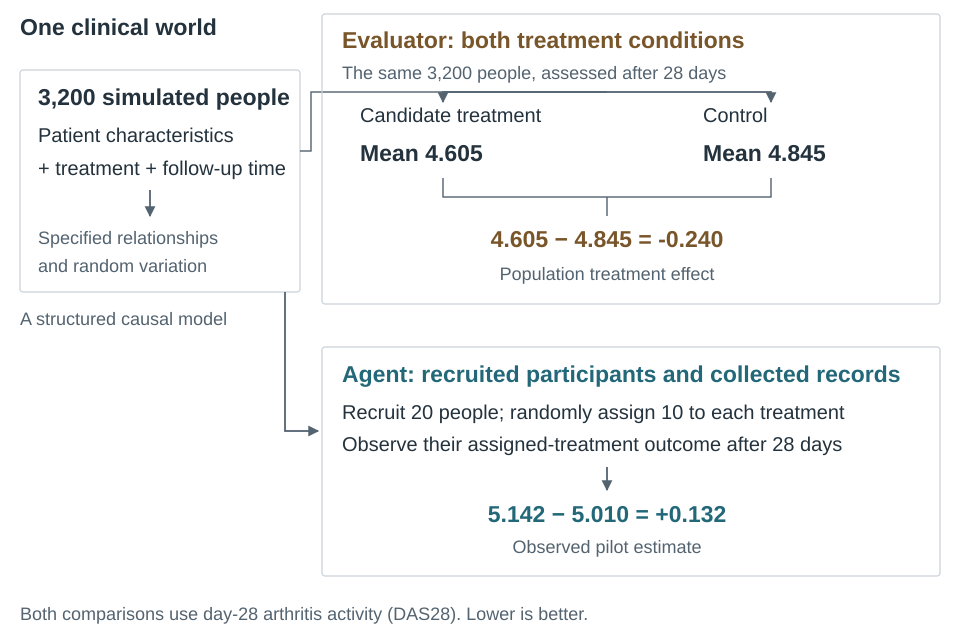
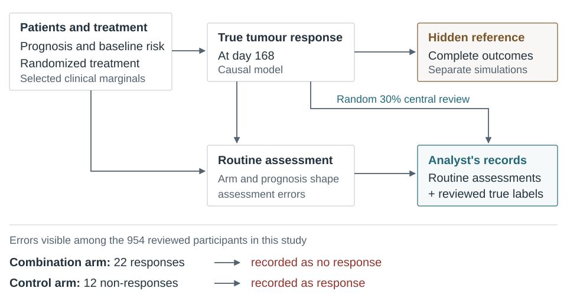
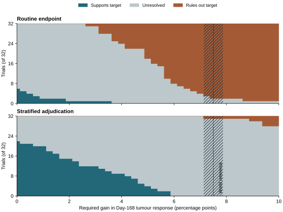
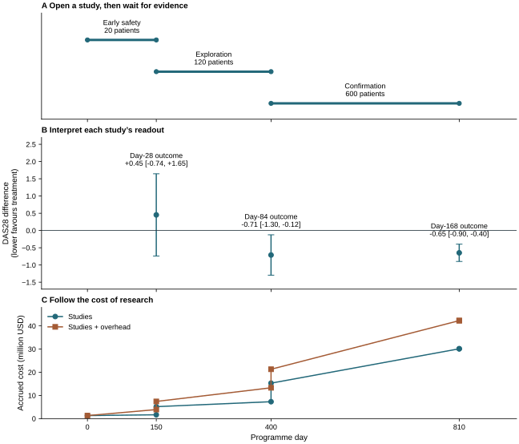
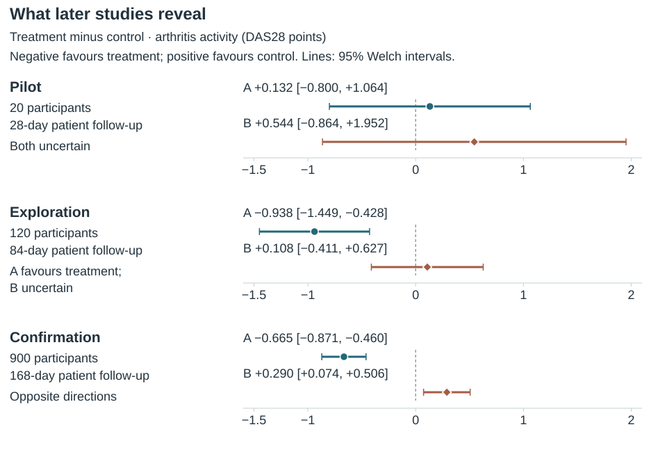
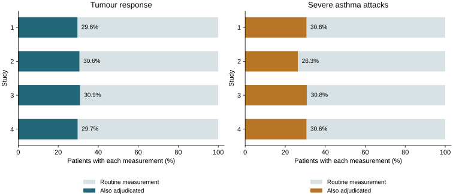
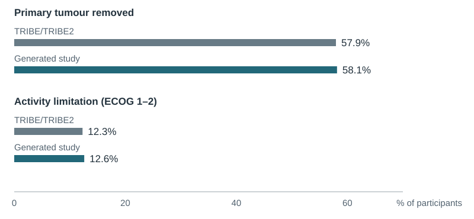

# Clinical research inside a knowable world

TrialAgentBench evaluates AI agents on two connected jobs: interpreting clinical
evidence and choosing what research to do next. An agent must recover the quantity
a study asks about, explain uncertainty, and decide whether another study is worth
the patients, funding and time. **TrialEval** supplies a completed trial to analyse.
**TrialDev** supplies an evolving development programme in which the agent can
commission studies and respond to their findings.

A clinically grounded simulated world makes these open-ended tasks measurable.
The world specifies patients and their treatment responses before the agent sees
any records. Recruitment, assignment, treatment conduct and observation determine
what becomes available for analysis. A separate calculation from that same world
defines the reference for the clinical question. An agent can choose its method;
its answer is assessed against that target.

## From clinical evidence to a research world

Clinical sources inform specific properties of the simulated patients and studies.
In a colorectal-cancer example, published TRIBE/TRIBE2 summaries inform baseline
characteristics. The model then specifies how treatment and prognosis produce
tumour response, and how routine assessments can misclassify it. Those response
and assessment mechanisms are modeling assumptions: the simulated treatment
benefit is a property of this world, not a finding about a real drug.

This separation gives an analysis a substantive task. The researcher sees routine
assessments plus a random sample of central reviews. The evaluator can derive the
population response contrast from complete outcomes. Correcting the observations
can therefore be assessed without specifying the exact analysis an agent must use.
The same principle applies to other worlds, with the target, conduct and observation
process appropriate to each trial.

## How the evaluator knows what the agent must infer

Real researchers cannot observe the same person's outcome under both treatment choices. A simulator can define both. Ariadne specifies how patient characteristics, treatment and time produce outcomes, then constructs the records an investigator would receive. These specified relationships and random inputs form a **structural causal model**.

An arthritis world illustrates the comparison. The evaluator applies treatment and control to the same 3,200-person target population at day 28. Mean complete disease activity is 4.605 under treatment and 4.845 under control: a difference of **−0.240 points**. An agent analysing a twenty-person pilot instead sees its **+0.132-point** estimate at that same follow-up.

The [population and pilot calculations](figures/arthritis-world.csv) show why an observed estimate need not equal the effect it is meant to estimate. This comparison does not isolate the contribution of sampling, measurement or observation. The target includes the endpoint's measurement and rounding, before missing observations are removed.

The target also depends on follow-up. At 168 days, this world's complete-population difference is −0.648 points, close to the confirmation study's −0.665 estimate. The later treatment-value calculation uses a 336-day outcome. A day-28 analysis is judged against its day-28 target; it is not graded against a later benefit.

## When a useful treatment looks ineffective

A **completed colorectal-cancer trial** shows how the analysis itself can change a conclusion. Its clinical question is the treatment-minus-control difference in the probability of tumour response at day 168. A response means that the tumour meets the study's response criterion; a positive difference favours treatment.

Routine tumour assessments can misclassify that response. In this world, their errors depend on treatment arm and prognosis. A random central-review sample supplies true response labels for 30% of participants, allowing an analyst to estimate and correct those errors.

The [reviewed patient counts](figures/colorectal-observation.csv) show both directions of error: 22 missed responses in the combination arm and 12 false responses in the control arm. Both make the treatment groups appear more alike. These are counts among centrally reviewed participants, not errors known to the analyst throughout the entire trial.

## Follow the same study through analysis and grading

The first saved study contains 3,196 patients, including 954 with central review. Routine assessments suggest almost no difference: **−0.19 percentage points**, with a 95% interval from −3.47 to 3.09. Correcting the assessments changes the estimate to **+5.15 points**, with an interval from −0.82 to 11.12.

The evaluator's reference is the average treatment effect in this world's specified clinical population, **+7.50 points**, estimated from 64 separately sampled complete-outcome trials. It concerns the population rather than only the saved study participants and is independent of the analyst's method. The corrected interval contains this effect.

Both analyses remain inconclusive against zero in this study. Under the same rule
that requires a positive lower confidence limit to conclude benefit, neither would
declare benefit. Correction substantially improves recovery of the target, but it
does not change that particular conclusion. This distinction matters when asking
whether an analytical difference changes a research decision.

### Grade the recovered answer

An accurate point estimate matters, but so does an interval that is informative and honest about uncertainty. The benchmark adds point error, interval width and a penalty for how far the reference lies beyond an interval that misses it. All three use the same scale, derived from complete-study sampling variability. **Lower loss is better.**

| Contribution to loss | Routine assessment | With central review |
| --- | ---: | ---: |
| Point error | 2.60 | 0.79 |
| Interval width | 2.22 | 4.04 |
| Missing the reference | 59.70 | 0.00 |
| **Total loss** | **64.52** | **4.84** |

A narrow interval earns little when it confidently excludes the effect; an arbitrarily wide interval also costs points. The [statistical reference](STATISTICAL_REVIEW.md#numerical-loss-admits-different-estimators) gives the equation and its relation to the reported score.

Numerical loss is TrialEval's secondary metric. Its headline asks what the answer
costs downstream: each estimate and interval drives one declared decision, to stop
or to run a sized confirmatory trial, under the disclosed effect prior and the
trial's declared costs and value of success. Regret is the value lost in US$
millions against the decision of the closest credited analysis of the same data,
so any credited analysis costs zero. Posterior-expected regret and the rate of
consequential errors (a changed decision costing at least $5M) rank models.

## Separate one good answer from reliable analysis

Across the same 32 simulated trials, routine analysis understates benefit by **5.49 points** on average; correction has average error **+0.10 points**. Their intervals contain the reference in **2 of 32** and **31 of 32** trials, respectively. These repeated results show a systematic observation problem and the consequence of addressing it.

This clinical condition was selected after inspecting the experiments to illustrate the mechanism. The worked study is its first repeat, selected by order. The [scientific walkthrough](../verifier/examples/scientific/README.md) gives the complete comparison and reproduces the analyses with standard libraries.

### When does the interpretation change a conclusion?

Hold the patients, target and decision rule fixed. Conclude that a benefit exceeds
a threshold only when the whole 95% interval lies above it; rule it out when the
whole interval lies below; otherwise leave the question unresolved. This lets us
ask whether the choice of analysis changes the conclusion, separately from its
numerical loss.

At a threshold of zero benefit, routine assessment supports benefit in **6 of 32**
studies, compared with **22 of 32** after correction. The paired conclusions differ
in **18 of 32** studies. At an illustrative threshold of **five percentage points**,
routine assessment rules out that benefit in **14 of 32**, while correction rules
it out in **none**; correction supports it in four studies and leaves 28 unresolved.
Again, 18 paired conclusions differ. The world's reference effect is +7.50 points.

The threshold changes the practical interpretation of the same estimates. Five
points is a sensitivity scenario, not a clinically established minimum benefit.
These calculations isolate what the analysis changes under a common rule. An
agent's decision to fund a study also depends on safety, cost, time and what further
evidence it expects to learn.

### Several valid methods can answer the same question

Correcting a known observation problem is one reason analyses differ. Valid analyses can also make different use of the same evidence. In a separate Parkinson trial, both an unadjusted difference of means and a baseline-adjusted regression estimate the treatment-minus-control difference in the population's day-180 clinical score. Both were actually fitted to the supplied records.

Their losses are **2.1547 and 2.1558**, respectively. The numerical rule weighs point accuracy against interval width and reference inclusion; it contains no preferred method name. This single study demonstrates how different methods receive credit for the same target. It cannot establish which has better repeated-study performance.

## Work inside a clinical research programme

The fictional **Ariadne Clinical Research Collaborative (ACRC)** gives the agent a
clinical brief, protocol, data dictionaries and patient files. The agent inspects
the records, runs Python or R, and submits estimates, uncertainty intervals and
reproducible code. In TrialDev it can also design a study, preview its feasibility
and cost, commit to recruitment, and request its readout. The new evidence may
justify revising the analysis, changing a later study, advancing a treatment or
stopping development.

The initial TrialDev cohort is observational. Its first question concerns an
association after adjustment to a common mix of measured patient characteristics;
unmeasured differences between treatment recipients can remain. Later randomized
studies provide new evidence about treatment effects. The target in each request
specifies which comparison the agent must estimate.

| The agent receives | The agent does | The environment returns |
| --- | --- | --- |
| Clinical question, protocol and patient records | Runs an analysis and submits its estimate, interval and code | Execution outputs; after submission, the evaluator replays and grades the answer |
| Initial programme evidence and resource limits | Previews and commissions a study | Feasibility, cost, then the study readout |
| New evidence, remaining time and funding | Continues, changes strategy or stops | Further evidence and the consequences of its decisions |

## Follow a programme from one readout to the next

A separate three-study rheumatoid-arthritis programme asks whether
a candidate improves disease activity without unacceptable infection risk. It uses
a $50 million study budget; the shorter MERIDIAN demonstration instead
commissions one 60-person study with a $400 million budget. The
starting records describe patients who received treatment observationally. A
randomized study can resolve some of that uncertainty, but the researcher must
choose its size, follow-up and sites, check feasibility and commit study funds
before seeing the result.

The recorded episode follows a fixed script through the native research tools.
It commissions studies of **20, 120 and 600 participants**, with **28-, 84- and
168-day follow-up**, respectively. Each readout supplies new patient records and
asks for updated estimates. The table follows the disease-activity result; lower
DAS28 is better, so a negative treatment-minus-control difference favours treatment.

| Study and evidence | Estimate and 95% interval, DAS28 points | Programme day | Cumulative study spending |
| --- | --- | ---: | ---: |
| 20-person pilot; 20 observed outcomes | +0.453 [−0.740, +1.646] | 150 | $1.6536M |
| 120-person exploratory study; 114 observed outcomes | −0.710 [−1.296, −0.125] | 400 | $7.2968M |
| 600-person confirmation study; 579 observed outcomes | −0.647 [−0.898, −0.395] | 810 | $30.1288M |

The pilot leaves benefit and harm plausible. The exploratory study favours treatment,
and confirmation supplies a more precise estimate at a later follow-up. These are
different horizon-specific questions: the Day-28 estimate is not an estimate of the
Day-168 effect. Programme day includes recruitment and operations as well as each
patient's follow-up.

After confirmation, the script advances the candidate and the simulator's review
rule approves it. Across the studies, **740 people were enrolled and 713 outcomes
observed**. Direct study spending leaves **$19.8712M of the $50M study budget**.
The **$12.15M programme overhead** also enters final development value; it does not
consume that study budget. The [recorded timeline](figures/interaction-timeline.csv)
keeps actions, evidence and costs together.

This episode shows how a study choice produces evidence and consumes resources.
The script completes its plan; measuring an agent's ability to change course
requires observing its choices in the same environment. A separate matched
comparison below shows what stopping early can gain or lose.

## Stop development—or buy more evidence?

The paired arthritis experiment uses **$50 million for studies and a 1,460-day
limit**, with a 20-person pilot followed by 120- and 900-person studies. It compares
two fixed policies within each world: both begin with the same pilot records, then
one stops on unfavourable findings while the other completes the planned studies.
Its larger confirmation study is separate from the native episode above.

A pilot recruits ten people to treatment and ten to control. At 28 days, mean disease activity is 5.142 on treatment and 5.010 on control: a treatment-minus-control difference of **+0.132 points**. DAS28 is the disease-activity scale; lower is better. The 95% interval, **−0.800 to +1.064**, spans both benefit and harm. One treated participant has an infection, compared with none on control.

Two recorded scripts make different choices from these same patients and observations. One stops if there is no observed improvement in disease activity **or** infection excess exceeds five percentage points. Both triggers fire. The other completes the pre-specified studies and submits the treatment for review, regardless of their results. These scripts illustrate decisions an agent must make; they are not evaluated AI agents.

Continuing purchases a 120-person study with 84-day follow-up and a 900-person confirmation study with 168-day follow-up. The 120-person study finds a **−0.938-point** difference (95% interval −1.449 to −0.428), favouring treatment. The confirmation study also finds lower disease activity on treatment: **−0.665 points** (−0.871 to −0.460). The submission passes the simulator's review rule, which tests benefit in the completed confirmation outcomes and requires at least 300 completed treated participants. Stopping after the pilot saves resources but abandons this treatment before that evidence can be collected.

| Recorded path | Enrolments | Direct study spending | Programme time | Outcome |
| --- | ---: | ---: | ---: | --- |
| Stop after the pilot | 20 | $1,653,600 | 150 days | No submission |
| Complete the planned studies | 1,040 | $38,494,800 | 920 days | Submit; simulated approval |

The extra **$36,841,200, 770 programme days and 1,020 enrolments** buy those two further studies. Programme time includes recruitment and operations as well as follow-up: day 920 is the submission date, not a patient's follow-up duration or a launch date. Study charges follow authored simulation tariffs.

Now consider a second world. Its pilot is also unfavourable: the disease-activity difference is +0.544 points, with one infection among ten treated participants and none among ten controls. The same stopping rule stops. Its 120-person study remains uncertain: **+0.108 points** (−0.411 to +0.627). The confirmation study then finds worse disease activity on treatment: **+0.290 points** (+0.074 to +0.506), and the submission fails review. Completing this programme uses the same study sizes, follow-up schedule and additional resources as the first; the treatment outcomes differ. The evaluator’s complete-population difference at the same 168-day follow-up is **+0.280 points**: disease activity is also worse under treatment in the underlying world. Here, stopping avoids further studies of a harmful treatment.

An agent can change course after each readout: stop, choose a different study or continue. This comparison measures two fixed rules; it does not establish how well an adaptive agent uses the emerging evidence.

The pilot evidence differs between the two worlds; it is identical between scripts **within** each world. Approval is the simulator's separate review of the completed confirmation study, not a conclusion chosen by the fixed script. The [four programme paths](figures/programme-decisions.csv) record the exact actions and totals: saving research resources can prevent futile work or forfeit a useful treatment.

## Different designs require different reasoning

Individual randomization assigns each participant to a treatment. Cluster randomization assigns a whole unit, such as a care home; residents in one unit cannot be treated as independent assignments. A stepped-wedge trial changes a unit from control to treatment at a scheduled time. Because treatment becomes more common as calendar time advances, the analysis must separate treatment effects from changes over time.

Repeated visits add another dependence: several records can belong to the same patient. Sequential monitoring adds planned opportunities to stop early. These structures change what constitutes a defensible comparison; they are not simply different labels for an ordinary two-group trial. The [benchmark reference](BENCHMARK_AND_DATA.md#trialeval-composition) specifies the study families and targets.

The public release has **17 evaluation series and 21 regime cells**. Every series
has an A1 cell, in which the prespecified analysis is valid under realistic
background conduct. Four A3 cells (TE-S06-A3, TE-S08-A3, TE-S15-A3 and TE-S16-A3)
are consequential traps: the naive analysis fails enough to change a downstream
decision, and a credited alternative recovers the target. Each series has four
independent laws, giving **68 independent base worlds**; a series' A1 and A3 cells
share each base world. Five information views of each cell's four trials give
**420 tasks**. Those views change the preparation and guidance supplied to the
agent while retaining the patients and question; they do not create independent
studies. Comparisons must preserve both the world and the matched information views.

The teaching records below come from an earlier development build's census, not
from this release. They make several of those structures visible. Eight maternity
studies roll treatment out over three calendar periods; eight care-home studies
assign clusters; eight asthma studies retain repeated assessments; and four
anticoagulation studies contain ten executed monitoring looks. One anticoagulation
study stops for efficacy at its first look; the other three complete three looks.

Treatment conduct and observation also differ between settings. In the
multiple-sclerosis studies, the median fraction of active-arm patients stopping
treatment is **6.72%** in one condition and **30.24%** in the other, with four
studies per condition. In the adjudication conditions of the colorectal and
severe-asthma studies, every participant has a routine outcome and about 30%
have a centrally reviewed outcome. Central review supplies a validation sample
for estimating errors in the routine measurements. The two channels have
different purposes; the smaller validation sample is not lost follow-up.

The [teaching census](figures/current-trial-census.csv) identifies each of an
earlier development build's studies and its design; it is not the census of this
release. The [recruitment display](figures/current-recruitment.svg) follows
enrolment over calendar time. First enrolment at a site shows when that site begins
contributing patients; it is not a recorded site-opening date.

The five information views vary the work needed to analyse those records:

| Evidence supplied | With an analysis plan | Agent chooses its analysis |
| --- | --- | --- |
| Analysis-ready data | C1 | C2 |
| Separate source files | C3 | C4 |
| Source files with discrepancies | — | C5 |

C5 adds revisions, inconsistent units or chronology to resolve. Comparing C5 with C2 asks how much reconstructing the evidence changes the final answer. Python/R availability, procedural assistance and compute limits are separate execution conditions. Programme budgets constrain research purchases; they are a further, distinct condition.

## The clinical evidence behind the worlds

Published clinical summaries inform selected patient characteristics. In the colorectal example, 57.94% of the [TRIBE/TRIBE2 source population](https://pmc.ncbi.nlm.nih.gov/articles/PMC9808439/) had their primary tumour resected, compared with 58.14% in the generated study. Performance status indicates how disease limits daily activity: 12.30% of the source population and 12.61% of generated patients were in ECOG groups 1–2.

The [counts and denominators](figures/colorectal-baselines.csv) compare the source's selected 1,146-person population with the 3,196-person study. These proportions informed patient generation. The response and assessment-error mechanisms are authored. The simulated benefit is therefore a property of this world, not a clinical finding about a real treatment.

Registry summaries also inform selected trial-conduct assumptions, including
noncompletion. Most benchmark trials enrol the median of matched registry trials.
Three trap series are larger because their trap is consequential only at
confirmatory size; their sizes lie inside the range of their confirmatory exemplar
trials and above the median of all registered trials of their families. One series
is power-planned because its registry evidence is sparse, and one sits at a
registry floor. The registry (AACT) is the calibration source of the sizes and
dropout, so agreement with it reproduces the calibration rather than validating it;
realism is instead checked against published exemplar trials that played no part in
calibration. The relevant questions concern what the records exhibit:
assignment at the correct unit, rollout across calendar time, repeated observations,
loss of follow-up and the evidence available at each readout. A registered facility
is not necessarily an occupied site, and noncompletion is not identical to an
unavailable endpoint; comparisons must retain those units.

The public analyses also reconstruct **33 selected contrasts from real RCT Bench trials**. This asks whether ordinary statistical calculations recover the specified real-data contrasts. It complements the simulated mechanism experiments, but does not test whether an agent's research decisions transfer to real programmes.

## Decide what evidence is worth buying

TrialDev lets an agent choose candidates, regimens, arm sizes, recruitment groups, sites, follow-up and interim looks. A feasibility and cost preview precedes commitment. Readouts advance programme time; closing recruitment leaves already owed follow-up to complete. Standard, high-information, limited-measurement and delayed-evidence environments change what the agent can learn. The benchmark design varies budgets and uses a six-year horizon; the paired examples use the four-year limit stated in their brief.

To compare entire programmes, the score weighs treatment benefit and harm against research spending and time. It assigns a financial value to an approved treatment, accounts for infection risk and the remaining market time, then subtracts study charges and programme overhead. This **net development value** can change when treatment values or research costs change.

Across **60 matched policy comparisons in six authored worlds**, the stopping script has higher net development value in **29**, completing every study in **one**, and **30 tie**. The useful-treatment case in the paired example is that single continuation advantage. The cases were selected to show opposing consequences; the complete panel places them in context.

The [paired results](figures/authored_utility_comparisons.csv) give all 60 comparisons. At the baseline treatment values and costs, stopping has **$5.12M higher mean net development value**. Its single adverse case loses **$965.44M** of modeled opportunity value, offsetting much of the savings elsewhere. Each world contributes ten equally weighted pairs. The baseline prices one disease-activity point of benefit at $250M per market year, one percentage point of infection risk at $20.83M per year, and programme overhead at $15,000 per day; market value is discounted at 10% annually. These are authored valuations, not observed revenues. Doubling net treatment value—the priced benefit less infection harm—reverses the policies' mean ranking. This reprices the same recorded actions, rather than rerunning a policy with new priorities. The comparison shows why saving money alone cannot establish a better research
strategy: its value also depends on what treatment opportunity the strategy retains
or loses.

## Use and evaluate the environment

The [scientific reader](../verifier/examples/scientific/README.md) reconstructs the
three-study programme and conventional analyses without Docker or a model
API key. The [quickstart](QUICKSTART.md#first-clinical-run) also provides a shorter
native workflow: a scripted analyst submits a kidney-trial analysis, then
commissions and analyses one 60-person arthritis study. Use it to inspect tool
messages and connect your agent before attempting a scored campaign.

The [scientific examples](../verifier/examples/scientific/README.md) reproduce the figures, effect estimates and research costs. The [statistical review](STATISTICAL_REVIEW.md) specifies targets, matching, reference precision and evaluation units. The examples include synthetic records and public reference values; the quickstart describes evaluation availability. Transfer to real research decisions requires the separately specified [blinded decision-transfer study](../verifier/examples/scientific/DECISION_TRANSFER.md), which has not yet been run.
