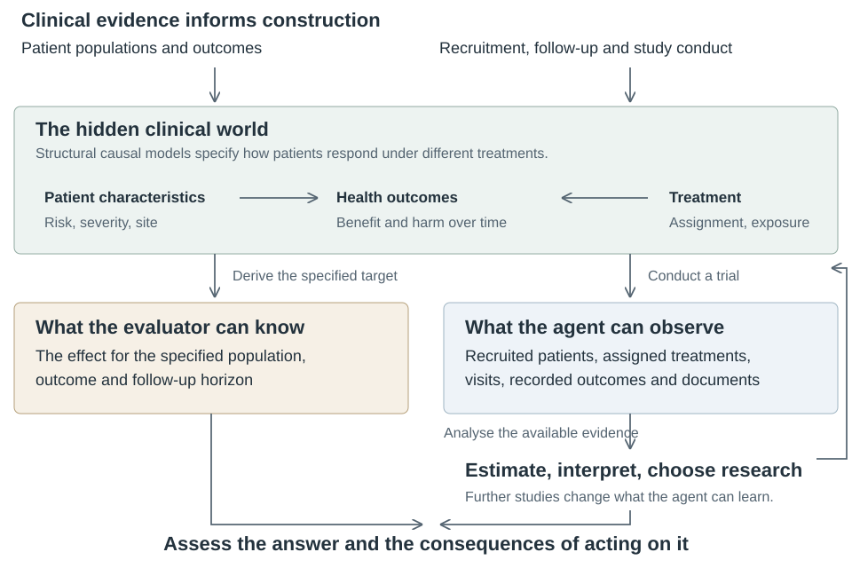
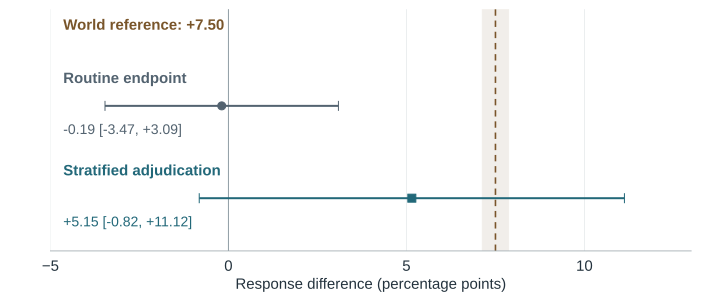
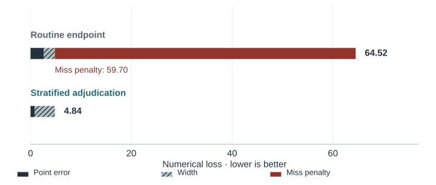
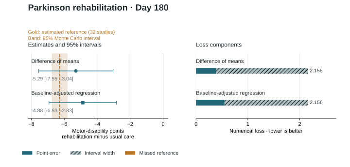
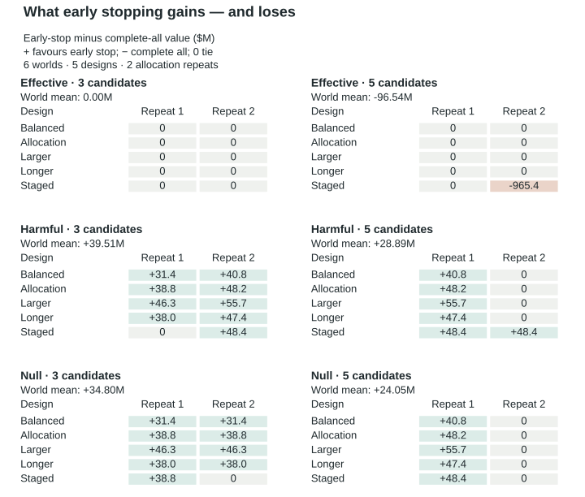

# TrialAgentBench: statistical methods and experimental units

TrialAgentBench evaluates how AI agents interpret clinical evidence and choose
research in simulated clinical worlds. TrialEval presents a completed trial;
TrialDev provides initial evidence and lets the agent acquire further studies
under funding and time constraints. The world defines each target independently
of the submitted method. Numerical loss measures recovery of that target;
development value measures the consequence of the research programme.

This reference follows the clinical question through its generating mechanisms,
conduct, observation, analysis and assessment. The [clinical guide](GUIDE.md)
connects those elements through worked cases, and the
[scientific reader](../verifier/examples/scientific/README.md) reproduces their
calculations with ordinary statistical libraries. Public examples use fixed
analyses and scripts; [the quickstart](QUICKSTART.md) distinguishes those runs
from scored agent evaluation.

## Clinical targets

Each question specifies a population, treatment comparison, endpoint, horizon,
effect scale and handling of intercurrent events. For example, a treatment-policy
question includes outcomes after treatment discontinuation. Losing contact then
creates missing data about that outcome; it does not remove the patient from the
question. Sensitivity analyses vary assumptions about the same estimand, whereas
changing the population or follow-up can define a different estimand.

TrialEval generally asks for population treatment contrasts. Initial TrialDev
questions concern observed associations standardized to the measured covariate
distribution of the starting cohort. A correct association can coexist with an
incorrect causal treatment ranking when unmeasured confounding remains. The
subsequent randomized studies and development objective have their own specified
populations and horizons. Numerical references preserve these distinctions.

## Generating mechanisms and empirical anchors



Ariadne specifies the patient characteristics, treatment responses and observation
processes needed for each clinical world. Its structural mechanisms connect parent
variables through functions, parameters and random inputs. Recruitment, assignment,
treatment conduct and follow-up produce a study; observation determines which
outcomes reach the analyst. Interventions change the relevant mechanism or
assignment and its downstream consequences. In the shared
observational/randomized pathway, private potential outcomes use common patient
characteristics and noise; their factual selection must reconstruct the observed
outcome. Dependence between baseline variables is separately specified and should
not be interpreted as a discovered causal relationship.

Published trial and observational summaries constrain selected components of this
construction. DAPA-CKD and QUEST inform baseline marginals in kidney and asthma
settings; the nested E-MOTIVE observational study informs maternity history
proportions. AACT family summaries provide trial-conduct targets, including
arm-specific noncompletion fractions used in observation models. The TrialEval
primary signal-to-noise prior uses the four-component normal mixture fitted by van
Zwet, Schwab and Senn to 23,551 Cochrane trials. Its sampled signal is mapped through
a compiled, series-specific signal-to-noise curve to the treatment-effect multiplier.
The mapping accommodates nonlinear risk and restricted-mean contrasts.

These inputs affect generation. Comparing the generated records with the same
sources checks attainment and interpretation of the calibration; it is not an
independent validation sample. Joint distributions, many conditional effects, longitudinal dynamics, treatment
values and research costs also contain modeling assumptions. A published median supports a location parameter, not an invented empirical density.
Registered facilities, occupied study sites and randomized clusters are different
units. Registry noncompletion and endpoint unavailability are different quantities.

External realism is therefore assessed against published exemplar trials rather
than the calibration registry. The public release's scorecard compares 112
series quantities (enrolment, occupied sites, horizon, control event proportion,
withdrawal, treatment discontinuation, baseline age and sex, and trap mechanism
strength) with ranges derived from those trials: 97 agree, 15 are declared
departures and 0 are undeclared. Most agreements use lenient tolerances: 74 of 91
series agreements use a widened or nearest-value tolerance. The trap strengths of
TE-S06-A3, TE-S15-A3 and TE-S16-A3 are among the declared departures, lying
outside published estimates (see *Disclosed limitations*). The scorecard covers the
public release only. The release evidence bundle's realism linkage
report (`realism/realism_linkage.md`) gives each value, its external range and the
exemplar trial locators. The realised effect distribution is judged against the
law the worlds are drawn from, the Cochrane mixture truncated to each series'
anchor range, which is disclosed: over 20,400 prior-drawn worlds, 0.261 of
the z statistics of each series' primary credited analysis lie beyond 1.96, inside
the interval 0.256–0.268 that law implies. Against the untruncated prespecified
mixture (0.285, interval 0.279–0.291; Kolmogorov–Smirnov distance 0.018) it is a
measured departure, and the departure equals the disclosed truncation.

## TrialEval: question, study and information

The public release has 17 evaluation series spanning survival, restricted mean
survival, longitudinal and continuous scores, binary outcomes and counts, and 21
regime cells: 17 A1 cells and four A3 trap cells (TE-S06-A3, TE-S08-A3, TE-S15-A3
and TE-S16-A3). Each series has four laws, giving 68 independent base worlds; a
series' A1 and A3 cells share each base world, so the cells are not independent
of one another. Each of the 84 cell-law trials is shown in five information
contexts, giving 420 tasks (84 per context; the 84 C5 tasks are the main
selection). The separately seeded withheld split presents only C5: 68
independent base worlds and 88 tasks, in the public cells plus one held-out trap
cell that never appears in the public split. The two splits share no base world.
Comparative uncertainty must retain world and context pairing; the unit of
evidence is the independent base world, not the task or the cell. The task manifest
and selected campaign panel determine the evaluated denominator.

| Dimension | Variation | Statistical interpretation |
| --- | --- | --- |
| Design | Individual and cluster assignment, stepped-wedge rollout, sequential monitoring, validation and population standardization | Changes the allocation, dependence, observation or target-population structure the analysis must respect |
| Assumption tier | A1 in every series (the prespecified analysis is valid under realistic background conduct); A3 in TE-S06, S08, S15 and S16 in the public split (the naive analysis fails consequentially and a credited alternative recovers). A2 and A4 are defined but have no cells | An excluded analysis is admitted as consequential only if it shifts by at least 1 grading SE in every effect tertile (inner 95% bound at least 0.8) or its intervals are at most 0.7× the credited width and fail calibration, does not win on squared error, and is not consequential in the series' A1 cell |
| Information context | C1 ready+plan; C2 ready without plan; C3 source+plan; C4 source without plan; C5 discrepant source without plan | Same question and patients with different preparation and guidance; C5/C2 is the principal paired comparison |
| Agent execution | Procedural assistance, analysis language, model configuration and compute limits | A run condition, separate from the clinical information context |

C5 includes discrepancies such as record revisions, units and identifiers. Public
provenance can support their resolution. Record reconstruction affects assessment through the submitted estimate and
interval. It receives no separate method-selection award. Each task must supply the information needed for its requested
answer; neither a hidden bias parameter nor a preferred method name is an answer.

The agent receives clinical documents and data dictionaries from the fictional
Ariadne Clinical Research Collaborative. It executes Python or R against read-only
evidence and saves its work in writable scratch space. Each submitted analysis is
replayed in fresh sessions. Reproduction binds the numerical report to its code
and evidence; it does not establish statistical validity.

### Observable trial structure in the teaching records

The [teaching census](figures/current-trial-census.csv) uses the clean participant
source records and analysis views of an earlier development build; it is not the
census of this release. In those records, maternity studies exhibit three-period rollout, care-home studies use
cluster assignment, asthma studies contain repeated assessments, and the sequential
anticoagulation studies supply realized interim looks, including a first-look
efficacy stop. In the colorectal-response and severe-asthma series (TE-S15 and
TE-S16), routine outcomes are recorded for all participants and central review
samples approximately 30% to assess measurement errors. Routine and adjudicated
outcomes are distinct channels; a smaller adjudication sample must not be
interpreted as lost routine follow-up. Maternity severe-morbidity proportions fall
across calendar periods while assignment changes from all usual care to all
pathway, which is why calendar period must be considered alongside treatment.
First enrolment at a site must not be interpreted as a site-opening timestamp.

Every cell carries registry-typical background conduct: survival treatment
discontinuation at the level typical of the matched registry trials (the realism
linkage report gives each series' observed share); treatment receipt and registry
dropout in the continuous and repeated series (missing at random on history in
TE-S12 and S13, completely at random elsewhere); registry dropout and
overdispersion in the count and binary series; and cluster frailty in the cluster
designs. Competing death, prognosis-driven censoring and non-proportional hazards
are not stacked, because each would change the question or invalidate the
credited analyses.

Each trial is sized to the median randomized enrolment of matched AACT trials
(snapshot 2026-08-01), with the exceptions stated here. TE-S06 (9,504
participants), TE-S08 (114,000) and TE-S15 (660) are sized at their trap's
consequence minimum: the trap is consequential at that confirmatory, power-planned
size. Their enrolment is not registry-calibrated, and the traps are not claimed to
be realistic at registry-median size. TE-S07 (7,680) is power-planned because its
registry evidence is only four trials, and TE-S10 (52) sits at a registry floor;
every other series uses its registry median. The teaching census, from an earlier development build, and the separate controlled
recovery experiments have different roles: one describes a set of realised tasks, the
other tests what selected mechanisms do to inference.

## Reference construction and repeated-study inference

TrialEval generally targets a population law. Independent simulator worlds retain
the same mechanism and effect state while changing their random seeds. Complete
private endpoint information supplies arm totals before observation selection;
these totals are pooled to estimate the requested population contrast. Whole-world
jackknife uncertainty and a fixed precision requirement accompany that reference.
The reference bank is extended or rejected if precision is insufficient. An exact
analytic null is used only where a scenario-specific proof supports it.

Finite-study arm contrasts remain diagnostic quantities. They are not substituted
for the population effect in grading. Population restrictions are applied as
specified: for example, the BMI-eligible reference population. Stepped-wedge
references evaluate fixed treatment regimes on paired enrolled units before
pooling. Measurement semantics also matter: a target can concern the complete
recorded endpoint, including its specified noise and rounding, rather than an
unrecorded physiological value.

Reference uncertainty differs from the sampling uncertainty in an agent's interval.
Repeated-study bias compares the mean estimate with the population target; coverage
compares intervals with that target. Increasing analysis repetitions does not remove
shared error in an estimated reference. Report the reference's Monte Carlo precision
and preserve the law or world as the relevant dependence unit.

The recovery panel contains 11 conditions across four families, with
32 analysis studies per condition and 64 reference studies per reference population.
Some conditions share seeds and complete-outcome references. In a selected tumour
adjudication setting, mean bias changes from −5.49 to +0.10 percentage points and
reference inclusion from 2/32 to 31/32 when the adjudication sample is used. These
are exploratory method results conditional on the estimated reference, not agent
performance or proof of nominal 95% coverage. The report includes contrary and
inconclusive comparisons. A separate same-target comparison of Welch and adjusted
analyses in the Parkinson example demonstrates how different computations submit
the same requested contrast; one realized study cannot establish their relative
operating characteristics.

## Numerical loss admits different estimators

Let the reference be θ, estimate x, reported interval [l,u], nominal confidence
1−α and frozen normalization scale s. The score is

```text
point loss    = |x − θ| / s
interval loss = [(u − l) + (2/α) max(0,l − θ) + (2/α) max(0,θ − u)] / s
target loss   = (point loss + interval loss) / 2
```

Lower loss is better. Interval width is costly, and noncoverage incurs an additional
penalty. The scale is fixed before agent evaluation; refining the numerical reference
does not redefine it. Rate ratios are evaluated on the log scale. Where a task
requests more than one target, the task loss is the equally weighted mean of its
target losses and requires every target to be reproduced. Each requested interval
has marginal coverage; joint 95% coverage is not implied.

The estimate and interval determine numerical loss. Method names, membership of a
reference-method catalogue and conformity to a named route do not. The clinical
question and evidence remain fixed, so estimating a different quantity is not
methodological plurality. An invalid analysis can occasionally achieve lower
realized loss through sampling variation or shrinkage; numerical loss is a repeated
performance measure, not a certification of each analytical choice.

Missing or unreproduced answers have unavailable numerical loss. Completion and
observed-case loss must be reported together; incomplete panels do not acquire a
full-panel numerical ranking. For TrialDev evidence analyses, a bounded companion
measure gives each participant failure zero and each scored task `1/(1+loss)`,
averaged over scheduled tasks under the declared campaign accounting; it does not
rank TrialEval. Operator-budget censoring is identified separately and requires the
common-panel comparison specified by the campaign.

TrialEval's headline is decision consequence, with numerical loss secondary. Each
answer drives one declared decision under the disclosed effect prior: stop, or
confirm with a confirmatory trial whose size is the expected-value-optimal multiple
(0.5 to 25) of the analysed trial's information. The economics are declared per
trial in its evaluator record: confirmatory cost per participant at 0.6×
the published average for the trial type; fixed cost $5.9M (industry) or $1.0M
(routine-data public health); value of success equal to median 10-year sales × 0.4
net × 0.446 present value ($2.5B × 0.446 for public health), which ranges from
$588.7M to $1,552.1M across the release cells. The headline is posterior-expected
regret in US$ millions under the closest credited analysis of the same data, so
any credited analysis costs zero. This headline averages over worlds drawn from
the disclosed prior. Regret at the true effect is reported alongside as a distinct
estimand: it is evaluated against the population targets of the release laws on
the coverage worlds, so it is conditional on those four laws per series and is not
a prior average. Mean regret and the consequential-error rate (a changed decision
costing at least $5M) are cell-balanced on the C5 view with world-clustered intervals, and a
sensitivity band reprices value and cost at ×0.5 and ×2.

Credited analyses are validated per cell at the release recovery precision:
1,200 prior-drawn worlds (bias envelope within ±0.2 SE; point bias at most
0.3 SE in each effect tertile) and 1,600 coverage worlds shared by both splits
(per-route Clopper–Pearson lower bound at least 0.88), with oracle Monte Carlo SE
at most 0.15 SD and a stratified census. Both splits are accepted with 0 failed
cells; 16 public cells have one credited route for their primary estimand and five
have two, and every credited route recovers. The harness identity is not bound to
qualification.

Fixed policies are priced over the same 1,200 prior-drawn worlds per cell, so
their costs are prior-averaged rather than conditional on one law. Of the
21 public cells, always taking the naive analysis fails 5, always taking the robust
analysis fails 1, following the plan fails 3, the prior-only policy fails all 21 and
the interval-gaming policies 20 or 21, and the scripted reference fails none. The naive answer's
posterior-expected regret per answer, in US$ millions, is 85.0 in TE-S06-A3 (45.2%
consequential), 42.3 in TE-S08-A3 (9.3%), 44.4 in TE-S15-A3 (25.6%) and 60.6 in
TE-S16-A3 (13.6%). In the withheld
split the naive analysis of the held-out trap costs 19.5 (11.2%). TE-S08's naive
route is the credited model without its period terms; in its A1 twin, where there
is no secular trend, this uncredited analysis costs 21.5 (9.2% consequential). The naive
answer's regret at the true effect, against the release laws' population targets
on each cell's 1,600 coverage worlds, is 61.8 in TE-S06-A3, 63.4 in TE-S08-A3, 68.6 in TE-S15-A3,
77.2 in TE-S16-A3 and −30.6 in TE-S08-A1. These law-conditional figures are not
interchangeable with the prior averages; the prior panel's in-sample regret is not
a true-effect measure and is not reported. Across the ×0.5 and ×2 value and cost
band the scripted reference fails no cell, and the shortcut and interval-gaming
controls fail cells at every point; at ×0.5 value and at ×2 cost the data-blind
always-robust policy passes every cell. This release reports no model comparison. A single-model end-to-end check (GPT-6 Luna on all 420 public and 88
withheld tasks) exercised the harness, grading and failure attribution; its
results are descriptive and are not a model ranking.

### Disclosed limitations

An independent statistical rigor audit recorded the following measured facts.
Each is a disclosed limitation of this release; where the release was changed in
response, the item says so.

- **Design coverage and replication.** There are no A2 or A4 cells. Public and
  withheld recovery are one shared acquisition, with one recovery plan and one set
  of 1,200 prior-drawn and 1,600 coverage worlds per cell, so agreement between
  the splits is not a replication. Trap consequence depends on the trap-minimum
  and power-planned sizes (TE-S06 9,504, TE-S08 114,000, TE-S15 660), far above
  registry medians.
- **TE-S08 trap identification.** TE-S08-A3 is admitted through the interval clause
  only (width ratio 0.501, shortcut coverage 0.419). Its excluded route is the
  credited model without period terms, with cluster jackknife intervals, and its A1
  twin shares no defect, so the A1/A3 contrast isolates the secular trend. In TE-S08-A1, which has no secular trend, that period-free analysis is unbiased and calibrated, but it omits the period adjustment a stepped-wedge analysis requires, so it is uncredited: the headline charges it $21.5M posterior-expected, while at the
  population targets it gains (−$30.6M), beating the credited analysis. It and the
  TE-S14-A1 routine contrast stay uncredited because the analysis-compatibility rule
  rejects them for their cell's design.
- **Realism.** Of the 112 scorecard cells, 0 are undeclared departures, but 74 of
  91 series agreements use widened or nearest-value tolerances, usually resting on
  one to three exemplar trials. The routine-sensitivity arm gaps of TE-S06-A3
  (0.098) and TE-S16-A3 (0.139) are declared departures three to four times beyond
  the published estimates (0–0.034), and the TE-S15-A3 case discordance (2.36%)
  lies outside its published range (5.4–20%). The withheld release and its
  held-out trap have no realism comparison. AACT both calibrates the sizes and
  dropout and serves as their reference, so agreement there is partly circular.
  The share of credited z beyond 1.96, 0.2606, lies inside the disclosed truncated
  prior's interval (0.2563–0.2684); against the untruncated prespecified mixture
  (0.2848, interval 0.2786–0.2910) the departure equals the disclosed truncation.
- **Policy panels.** At value ×0.5 and at cost ×2 the data-blind always-robust policy fails no
  cell, so that control does not separate at those ends of the band. TrialDev
  meets its design requirement in every programme at profit ×0.5, ×1 and
  ×2: the reference is a strong baseline, stopping is optimal in a minority of
  programmes (23–38%), and attainable value rises from the 0.75× to the 1.1×
  budget (z 6.4–9.4). The reference policy does not itself convert extra
  budget into value, because its exploration size and site network are fixed
  rules.
- **Qualification gates.** The support threshold of 0.8, the 1.25 no-inversion
  factor, the 0.8 inner shift bound and the effect-anchor tolerance were
  provisional when the audit recorded them. Each retained gate is now derived from
  the consequence threshold: the inner bound is the threshold less the credited-bias
  tolerance, no-inversion is a paired one-sided 95% test that replaces the 1.25
  factor, support is an availability rule and the anchor check is a gross-error
  screen. The anchor comparator was changed to credited z after release qualification
  failed on the stale comparator, and the world counts were doubled after a failing
  development draw.

## One complete grading example

The first saved colorectal study has 3,196 participants and 954 centrally adjudicated responses. Routine analysis gives a response difference of −0.19 percentage points (95% interval −3.47 to 3.09); stratified correction gives +5.15 (−0.82 to 11.12). A separate 64-study complete-outcome reference is +7.50 points, with Monte Carlo standard error 0.185 points. The condition was selected after inspection to illustrate recovery; the worked repeat was selected by its index, not its result.



With reference θ and complete-study standard deviation s, numerical loss is
`L = (|estimate − θ| + interval width + 40 × distance outside interval) / (2s)`.
Here s = 0.014776 in risk-difference units. The three contributions are 2.602 + 2.219 + 59.702 = 64.522 for routine analysis and 0.795 + 4.042 + 0 = 4.836 for correction. The normalized recovery score is `1/(1+L)`. Wider uncertainty earns a width penalty but can avoid a much larger noncoverage penalty. The corrected interval includes zero; recovering the simulated effect is distinct from declaring benefit in this single study.



[Exact inputs and components](figures/colorectal-recovery.csv) ship with this guide. The [public reproduction script](../verifier/examples/scientific/review_adjudication.py) re-fits both methods, derives the reference and checks every component against the canonical scoring function. TRIBE/TRIBE2 informs selected baseline marginals; the response law, assessment errors and 30% review design are authored.

### From numerical recovery to a consequential interpretation

The colorectal comparison also applies one interval-based conclusion rule to both
methods on each of the same 32 studies. For a benefit threshold b, an interval with
lower bound above b supports benefit greater than b; an upper bound below b rules
it out; an interval containing b leaves it unresolved. The evidence, target and
rule are held fixed, so a within-study change in conclusion is attributable to the
analysis. The threshold sweep from zero to ten percentage points examines how
that consequence depends on the benefit required.

At b = 0, routine assessment supports benefit in 6/32 studies and correction in
22/32; 18 paired conclusions differ. At b = 5 percentage points, routine assessment
rules out the target benefit in 14/32 studies, whereas correction does so in 0/32,
supports it in 4/32 and leaves 28/32 unresolved. Eighteen paired conclusions again
differ. The population reference is +7.50 percentage points, with Monte Carlo
95% interval +7.13 to +7.87. The worked first study remains unresolved at b = 0
under both methods, despite their markedly different numerical losses.

The [threshold results](figures/interpretation-materiality-summary.csv) retain each
method, conclusion and study count. These are exploratory consequences of a fixed
interpretation rule in one selected mechanism condition. The thresholds are sensitivity scenarios rather than clinical
minimum-benefit standards. No study is commissioned by this calculation; it does
not measure an agent's research choices or their transfer to real programmes.

### A same-target comparison of valid estimators

The Parkinson study compares an unadjusted Welch difference of means with baseline-adjusted regression using HC3 uncertainty. Both target the same day-180 population mean difference and use the same supplied study. The independent reference bank has 32 worlds; its complete-study normalization scale is 1.27606068843. Numerical losses are 2.15467545531 and 2.15576465286. Their near equality reflects the trade-off between point error and interval width in this realized study, not a general equivalence of operating characteristics.



The [method results](figures/method_plurality.csv) retain estimates, intervals, reference precision and loss components.

## TrialDev: learning and choosing under resources

TrialDev covers rheumatoid arthritis, migraine, atopic dermatitis and COPD, with
three or five candidates. Initial questions concern associations standardized to
the measured covariate distribution in the starting cohort. Measured overlap,
limited overlap, residual confounding and near-tied benefits change what that
evidence can distinguish. Near-tied benefit does not imply equal safety. A correct
initial association does not establish the causal treatment ranking.

The agent authors randomized individual-level studies within public constraints:
candidate and regimen, arms and allocation, recruitment groups, sites, follow-up,
assessment schedules and interim looks. A feasibility/cost preview precedes
commitment. Study readouts reveal observations available at their programme date;
future observations and complete private outcomes remain unavailable. The agent
can change later studies, close recruitment, switch candidates or stop, retaining
costs and follow-up obligations already incurred.

The benchmark design comprises 384 programme worlds, each with three research budgets
(0.75, 1.1 and 2.5 times the programme's lean-programme cost, from $30m–$35m to
$100m–$118m) and a six-year horizon. The initial-analysis and development
tasks have raw and prepared views. The qualified public release (regenerated for
this release with a recentred candidate prior) has 3,072 tasks; the withheld release has 64
programmes and 512 tasks. Standard-information, high-information,
limited-measurement and delayed-evidence profiles vary several properties together,
including starting sample, observation, measurement, cost and duration. They are
research-environment packages, not isolated causal effects of one component.

A study's numerical reference concerns the complete programme population at that
study's horizon. The private approval calculation uses completed confirmation
outcomes from enrolled patients; terminal value uses benefit and harm for the
programme target population and final horizon. Enrichment and shortened follow-up
can therefore change information and approval without redefining the population
whose treatment benefit is valued.

Development value combines approved benefit, priced safety risk, discounted market
time, study expenditure and overhead. Stopping retains expenditure; an unfinished
programme has no terminal value. This is an explicit sponsor objective, not a
patient-welfare estimate. Initial-analysis loss, acquired-study loss and terminal
value are reported separately. Repricing fixed study actions tests objective
sensitivity; testing adaptation requires rerunning the policy under the changed
objective. Research dollars and calendar years are distinct from model charges
and executor time.

### Evidence and actions in the recorded research episode

The MERIDIAN episode executes a fixed script through three native studies: 20,
120 and 600 participants at follow-up horizons of 28, 84 and 168 days. Readouts
arrive on programme days 150, 400 and 810. They contain 20, 114 and 579 observed
disease-activity outcomes, respectively. The corresponding treatment-minus-control
estimates are +0.453 (95% interval −0.740 to +1.646), −0.710 (−1.296 to −0.125)
and −0.647 (−0.898 to −0.395) DAS28 points. Each estimate concerns its study's
follow-up, rather than one invariant treatment effect at three dates.

Cumulative direct study charges are $1.6536M, $7.2968M and $30.1288M. At day 810,
programme overhead is $12.15M, bringing study charges plus overhead to $42.2788M.
The remaining study budget is $19.8712M because overhead enters terminal value
separately. The script advances the candidate after confirmation and the native
review rule approves it. Available readouts, complete confirmation outcomes used
in review and the programme-population contrasts used for value have distinct
roles. The [action timeline](figures/interaction-timeline.csv) connects the
executed study requests to released evidence and resources.

This sequence establishes the consequences of its recorded actions. It does not
measure an AI agent or exercise every supported adaptation. The separate policy
comparison below varies the decision to continue within matched worlds.

### The matched programme comparison

The illustrated arthritis comparison uses six authored worlds, five study designs, two allocation repeats and two scripted policies: **60 within-world pairs, 120 programmes**. The responsive script stops when the observed disease-activity difference is nonnegative or infection excess exceeds five percentage points. The fixed script completes its specified studies and submits regardless of their readouts. Shared early patients and evidence are matched within each world and repeat; evidence is not identical across worlds.

The four illustrated paths use the staged design, allocation repeat 1, a $50M study budget and a 1,460-day programme limit. The first world is `tdw-70ff3604b8a7`, candidate `mrd-46523`; the second is `tdw-84fc2dcd0306`, candidate `mrd-19769`, both at standard dose. Their 20-person day-28 pilots have disease-activity differences +0.132 and +0.544 points, respectively, with one infection among ten treated patients and none among ten controls. The responsive script stops in both worlds; the fixed script continues to 120-person day-84 and 900-person day-168 studies.

| World and path | Enrolments | Direct study charges | Terminal programme day | Action and review |
| --- | ---: | ---: | ---: | --- |
| First world, responsive | 20 | $1,653,600 | 150 | Stop; no submission |
| First world, fixed | 1,040 | $38,494,800 | 920 | Submit; approved |
| Second world, responsive | 20 | $1,653,600 | 150 | Stop; no submission |
| Second world, fixed | 1,040 | $38,494,800 | 920 | Submit; rejected |

These [four paths](figures/programme-decisions.csv) differ by $36,841,200, 770 programme days and 1,020 enrolments within each world. Day 920 denotes submission. The value calculation applies a further 365-day launch delay; submission, approval and launch are distinct events. Study charges apply authored tariffs to executed recruitment and follow-up. Programme overhead is additional and enters sponsor value; agent-compute charges are separate again.

At day 28, the first world's complete-population contrast is −0.23980625 points; its pilot estimate is +0.132. At day 168, its complete contrast is −0.647834375 and observed confirmation difference −0.665288889. The second world's corresponding complete contrasts are +0.1012 and +0.279671875, with observed confirmation difference +0.289597685. These are horizon-specific contrasts for the same programme populations, including measurement and rounding before observation masking. Terminal treatment value uses day-336 contrasts of −0.6934375 and +0.2983125. Approval instead uses completed confirmation outcomes and the simulated review rule, including its minimum of 300 completed treated participants.

Sponsor value prices approved population benefit and infection risk over discounted market time, then deducts study charges and overhead. It is an authored objective, not realised revenue or patient welfare. The first illustrated pair is the **only one of 60** where fixed continuation has higher sponsor value; responsive stopping has higher value in 29 and 30 tie. The pair was selected after examining the panel to demonstrate a possible opportunity cost. The six worlds and their allocation repeats do not form a representative sample of benchmark worlds.



The [paired comparisons](figures/authored_utility_comparisons.csv) and [valuation summaries](figures/authored_utility_summary.csv) retain the full finite panel. Revaluing the same actions with twice the net treatment value (priced benefit less infection harm) reverses the mean policy ranking. This sensitivity analysis holds decisions, approval and timing fixed; it does not measure how a policy adapts to new preferences. No population confidence interval is inferred from these six selected worlds.

## Interpretation and comparison units

The teaching census describes the records of an earlier development build's tasks. Controlled
recovery experiments test selected mechanisms through repeated studies, while the
native episode shows how a sequence of research actions changes evidence, spending
and time. The six-world policy comparison assesses two fixed strategies and their
valuation sensitivity. These demonstrations establish neither an AI ranking nor
average decision performance across benchmark worlds.

Agent comparisons require complete scheduled denominators and matched conditions.
Keep linked information views, resource conditions and repetitions together when
resampling independent worlds. Numerical recovery, task completion, research value
and computational expense answer different questions and should remain visible.

The real-trial experiment tests numerical reconstruction on real records. Transfer
of agent research decisions requires the separately specified
[blinded decision-transfer study](../verifier/examples/scientific/DECISION_TRANSFER.md)
of real programme dossiers; that study has not yet been run.
