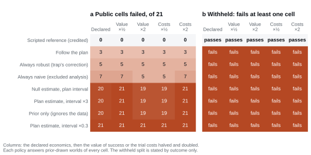

# Demonstrations

A benchmark score is only worth reading if the tasks behind it test what they claim to test. These
three demonstrations let you check that with ordinary statistical libraries and without running a
model. Each answers one question a sceptical reader might ask, states in advance what it uses, and
writes its figure, the exact values it plots (CSV) and a printed summary.

The sponsor, Ariadne Clinical Research Collaborative, and all simulated trial and programme names
are fictional. The demonstrations reuse its sponsor and document formatting.

| Demonstration | Question | Reads | First run |
| --- | --- | --- | --- |
| `decision_layer.py` | How is an answer priced, and does distorting it pay? | The verifier's public decision layer only | No download, seconds |
| `release_panel.py` | Could a strategy that ignores the data score well? | The release-evidence record | Under 1 MB, seconds |
| `trialdev_budget.py` | Does a better evidence strategy turn budget into development value? | The release-evidence record | Under 1 MB, seconds |

## Running them

Run from the public repository root with its locked environment installed (`uv sync --locked`):

```bash
uv run python examples/decision_layer.py --output results/decision-layer
uv run python examples/release_panel.py --output results/release-panel
uv run python examples/trialdev_budget.py --output results/trialdev-budget
```

The release-panel and budget demonstrations download what they need from the
[Hugging Face dataset](https://huggingface.co/datasets/TrialAgentBench/TrialAgentBench) at revision
`v1.0.0` into the operator cache (`$TRIALAGENTBENCH_CACHE_DIR`, or `~/.cache/trialagentbench`).
Every file is checked against the dataset's `SHA256SUMS`. To work offline, pass `--release-root` with a
local copy of the dataset (the directory holding `SHA256SUMS`); `--revision` selects another published
revision. No credentials are used.

The figures in [`docs/figures/`](../docs/figures/) are these outputs for the published release.

## How an answer is priced

**Question.** How does an estimate and its interval become a development decision, and can an agent gain
by reporting something other than what its data say?

```bash
uv run python examples/decision_layer.py --output results/decision-layer
```


Every TrialEval answer drives one decision through the verifier's public decision layer
(`decision_consequence_v1`): stop, or run a confirmatory trial of a chosen multiple of the analysed
trial's size, whichever has the larger expected value under the disclosed effect prior and the trial's
declared economics. The demonstration uses that layer alone, with representative economics and no task
data. Panel a sweeps the reported estimate for an honest interval, one half as wide and one twice as
wide, and draws the confirmatory trial each report drives. Panel b draws worlds from the disclosed
prior and prices five distortions of the honest report against it: an estimate moved one standard error
either way, an interval halved or doubled, and the agent's own shrinkage towards the prior, which the
layer then applies a second time. Each costs regret, because the layer already combines the report with
the prior; the label gives the share of worlds in which the distortion is a consequential error.

**Boundary.** The economics are representative values inside the declared ranges, not any one trial's;
each task's own economics are in its evaluator record. The demonstration shows the grading rule, not how
any agent behaves.

## No shortcut passes

**Question.** Could an agent score well by following a fixed rule instead of reading the data?

```bash
uv run python examples/release_panel.py --output results/release-panel
```



The release record runs fixed answer policies through every TrialEval cell of both splits over
prior-drawn worlds: **Always naive**, **Always robust**, **Follow the plan**, **Prior only** and
three variants of **Interval gaming**. The public panel counts the cells each policy fails;
the withheld panel states only whether it fails at least one cell, labelled "fails" or "passes".
Both show the declared economics and the value of success or the trial costs halved and doubled.
**Scripted reference** reports the cell's credited analysis. A band point at which a fixed rule fails
no cell appears as zero in the public panel or "passes" in the withheld panel, where the outcome
cannot separate that rule from the reference. No withheld failed-cell count is published. The
demonstration reads every policy, band point and split in the record and omits nothing.

**Boundary.** The panel prices fixed rules, not models; it shows that the benchmark can separate
data-reading from data-blind behaviour, not how any agent behaves.

## Budget buys evidence, evidence buys value

**Question.** In TrialDev, does commissioning evidence well turn a larger budget into development
value?

```bash
uv run python examples/trialdev_budget.py --output results/trialdev-budget
```


Every public TrialDev world is run at its constrained, lean and generous budgets by **Attainable
oracle**, which knows the true effects, and **Reference**, which sees only the evidence it buys. Each world
is replayed under shared recruitment seeds, because one programme's approval draw alone moves its
value by hundreds of millions. The release record publishes the resulting means; the demonstration
draws every clinical programme in it, labelling each step with its 95% interval over worlds, and stops
if the record does not yet carry the resource-gradient panel.

**Boundary.** Attainable oracle and Reference run in the release build, not in this script, which
reads their published results. Values are risk-adjusted under the benchmark's declared economics.
Candidates differ only through acquired evidence. Progression and approval are simplified benchmark
rules, not regulatory practice; [METHODS §§5–7](../docs/METHODS.md#5-trialdev-composition) give their definitions.

## The offline walkthrough

`uv run trialagentbench demo run --output results/demo` runs one released TrialEval task and one disclosed
development TrialDev world end to end through the harness, offline and without credentials, with a disclosed
scripted analyst in place of a model. [clinical/README.md](clinical/README.md) explains it and how to
connect your own agent. It needs the built Docker executor; it needs no model, credential or dataset
download. The two teaching archives are bundled with the harness.

## Optional: real trials

[`verifier/examples/scientific/review_external.py`](../verifier/examples/scientific/review_external.py) reproduces the benchmark's analysis experiment on
real trials. From a separately acquired RCT Bench checkout (passed with `--source`), it screens the
published participant-level trials, fits the declared covariate-adjusted treatment contrast, and
compares resampling whole participants with resampling that breaks the link between each
participant's measurements. Its expected values live in `verifier/examples/scientific/external/`,
and it uses only ordinary libraries. It is the one demonstration on real rather than simulated
trials; it needs the external checkout and is not run in continuous integration.

```bash
uv run python verifier/examples/scientific/review_external.py \
  --source /path/to/rct-bench --output results/external-trials
```
