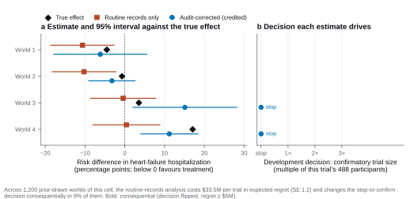
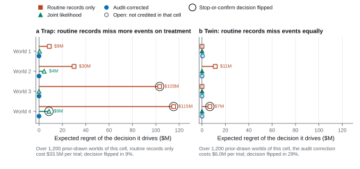

# Demonstrations

A benchmark score is only worth reading if the tasks behind it test what they claim to test. These
four demonstrations let you check that from the published data, with ordinary statistical libraries
and without running a model. Each answers one question a sceptical reader might ask, states in
advance which tasks or records it uses, and writes its figure, the exact values it plots (CSV) and a
printed summary.

| Demonstration | Question | Reads | First run |
| --- | --- | --- | --- |
| `trap_decision.py` (trap) | What happens when the usual analysis is wrong for the data? | Participant tables and evaluator records of eight public tasks | About 200 MB download, then seconds |
| `trap_decision.py` (twin) | Does the benchmark punish correcting a problem the data do not have? | The same run | — |
| `release_panel.py` | Could a strategy that ignores the data score well? | The release-evidence record | Under 1 MB, seconds |
| `trialdev_budget.py` | Does a better evidence strategy turn budget into development value? | The release-evidence record | Under 1 MB, seconds |

## Running them

From a checkout of this repository with its environment installed (`uv sync`):

```bash
uv run python examples/trap_decision.py --output results/trap-decision
uv run python examples/release_panel.py --output results/release-panel
uv run python examples/trialdev_budget.py --output results/trialdev-budget
```

Each demonstration downloads what it needs from the
[Hugging Face dataset](https://huggingface.co/datasets/TrialAgentBench/TrialAgentBench) at revision
`v1.0.0` into the operator cache (`$TRIALAGENTBENCH_CACHE_DIR`, or `~/.cache/trialagentbench`).
Every small file is checked against the dataset's `SHA256SUMS`, and task data are fetched shard by
shard with the verifier's asset cache, which checks each shard against its catalog. To work offline,
pass `--release-root` with a local copy of the dataset (the directory holding `SHA256SUMS` and
`full/`); `--revision` selects another published revision. No credentials are used.

The figures in [`docs/figures/`](../docs/figures/) are these outputs for the published release.

## A confident wrong decision

**Question.** In some trials the analysis a careful analyst would run by default fails on the data.
What does that cost?

```bash
uv run python examples/trap_decision.py --output results/trap-decision
```



The trials test a device for chronic heart failure, with hospitalization for heart failure by day
548 as the endpoint. Sites record hospitalizations routinely, and a blinded committee adjudicates a
risk-stratified sample of participants (40% at lower risk, 60% at higher risk). In the trap cell, routine records miss more events on the treated arm,
so the routine-record risk difference flatters the device. The analysis the benchmark credits adds
each arm's audit discrepancy back to its routine risk.

The demonstration rebuilds both analyses from the raw participant tables of every public world of
the trap cell (TE-S06-A3, evidence context C5) and stops unless its credited analysis reproduces the
credited reference in the public evaluator record. It then passes each estimate and interval to the
verifier's public decision layer (`decision_consequence_v1`), which chooses the expected-value-optimal
development action: stop, or run a confirmatory trial of a chosen multiple of this trial's size.
Panel a compares each estimate with the true effect; panel b shows the action each estimate drives
and its expected regret, in US$ millions, against the credited analysis. In the world where the
treatment is truly slightly harmful, the routine records point to benefit and the decision layer
confirms; the audit-corrected answer stops. The footnote gives the same cost over the cell's
prior-drawn worlds from the release-evidence record, so the four public worlds are not the whole
evidence.

**Boundary.** Four worlds illustrate the mechanism; the cell-level cost comes from the release record.
Effects and economics are simulated, with declared values; the decision layer is the benchmark's
grading rule, not a model of any sponsor.

## Correcting when you should not

**Question.** Does the benchmark simply reward applying every available correction?

The same run writes the second figure.



Each trap has a twin built on the same base worlds with documents that differ only in identifiers
and dates. In the twin, routine records miss events equally on both arms. The credited analysis there
is the joint likelihood of routine and adjudicated records; the trap's audit correction is still
unbiased but uses the audit sample less efficiently, so its wider interval changes decisions. The
demonstration runs all three analyses on every public world of both cells (the twin is found as the
one other cell of the series with the trap's base worlds) and prices them as before. The analysis that
costs nothing in one cell costs money in the other: the right analysis depends on the data, not on
the protocol. The notes under each panel give the cell-level costs from the release record.

**Boundary.** In most single worlds the correction and the default lead to the same decision; the
claim rests on the share of worlds in which they do not, which the release record reports.

## No shortcut passes

**Question.** Could an agent score well by following a fixed rule instead of reading the data?

```bash
uv run python examples/release_panel.py --output results/release-panel
```


The release record runs fixed answer policies through every public TrialEval cell over prior-drawn
worlds: always the shortcut, always the trap's correction, the analysis plan, the prior alone, and
three ways of gaming the interval. Panel a counts the cells each policy fails at the declared
economics and with the value of success or the trial costs halved and doubled. The reference policy,
which reports the cell's credited analysis, fails none at any point of the band; the fixed rules
fail cells, and the gaming rules fail almost all of them. Panel b shows why the traps bite: in every trap the
excluded analysis moves the estimate by more than one standard error in every tertile of the true
effect, except one trap that is admitted because its interval is overconfident (open markers). The
demonstration reads every policy, band point and trap in the record and omits nothing.

**Boundary.** The panel prices fixed rules, not models; it shows that the benchmark can separate
data-reading from data-blind behaviour, not how any agent behaves.

## Budget buys evidence, evidence buys value

**Question.** In TrialDev, does commissioning evidence well turn a larger budget into development
value?

```bash
uv run python examples/trialdev_budget.py --output results/trialdev-budget
```

Every public TrialDev world is run at its constrained, lean and generous budgets by an oracle that
knows the true effects and by the reference policy, which sees only the evidence it buys. Each world
is replayed under shared recruitment seeds, because one programme's approval draw alone moves its
value by hundreds of millions. The release record publishes the resulting means; the demonstration
draws every clinical programme in it, labelling each step with its 95% interval over worlds, and stops
if the record does not yet carry the resource-gradient panel.

**Boundary.** The oracle and reference policies run in the release build, not in this script, which
reads their published results. Values are risk-adjusted under the benchmark's declared economics.

## The offline walkthrough

`trialagentbench demo run --output results/demo` runs one released TrialEval task and one released
TrialDev world end to end through the harness, offline and without credentials, with a disclosed
scripted analyst in place of a model. [clinical/README.md](clinical/README.md) explains it and how to
connect your own agent. Maintainers rebuild its two small archives from a published release with
`construction/examples/build_public_demo.py --release-root DATASET_COPY`.

## Optional: real trials

`../verifier/examples/scientific/review_external.py` reproduces the benchmark's analysis experiment on
real trials. From a separately acquired RCT Bench checkout (passed with `--source`), it screens the
published participant-level trials, fits the declared covariate-adjusted treatment contrast, and
compares resampling whole participants with resampling that breaks the link between each
participant's measurements. Its expected values live in `../verifier/examples/scientific/external/`,
and it uses only ordinary libraries. It is the one demonstration on real rather than simulated
trials; it needs the external checkout and is not run in continuous integration.
