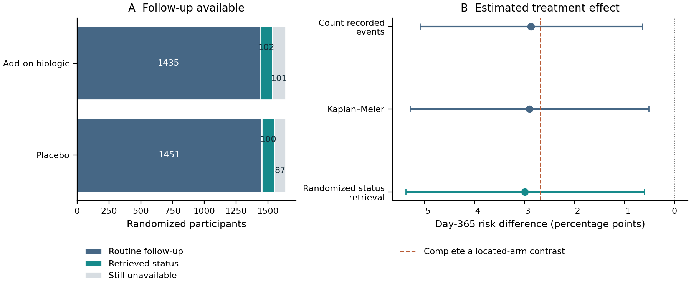

# A randomized asthma trial

## Question and design

Does adding a biologic to optimized inhaled treatment reduce the risk of a severe asthma exacerbation by Day 365? This simulated trial randomized 3,276 adults 1:1 to add-on biologic or placebo, in blocks of 4. The question concerns assignment, including outcomes after treatment discontinuation.

The cohort size comes from a prespecified nominal proportional-hazards planning alternative: hazard ratio 0.7047, two-sided alpha 0.05, power 0.9, equal allocation, and event yield 0.1050. Schoenfeld's event formula gives 343.1 events, rounded up to 344; division by event yield and rounding to blocks of 4 gives 3,276 patients. This plans the reference scenario, not achieved power under this example's losses and treatment discontinuation.

## Table 1. Participants at randomization

| Characteristic, mean (SD) | Placebo | Add-on biologic |
| --- | ---: | ---: |
| Age, years | 50.3 (13.1) | 50.3 (13.1) |
| Severe exacerbations in the previous year | 2.0 (1.4) | 2.0 (1.4) |
| FEV1, % predicted | 57.8 (14.3) | 57.7 (14.0) |

## Follow-up and reconstruction

| Participants | Placebo | Add-on biologic |
| --- | ---: | ---: |
| Randomized | 1638 | 1638 |
| Exacerbation recorded before loss/end of follow-up | 220 | 173 |
| Day-365 status known from routine follow-up | 1451 | 1435 |
| Status initially unavailable | 187 | 203 |
| Status retrieved in the randomized follow-up sample | 100 | 102 |
| Status still unavailable | 87 | 101 |
| Recorded systemic hypersensitivity | 26 | 43 |

Patient identifiers link assignment and baseline records to events, follow-up endings and retrieved assessments. Retrieval establishes whether an exacerbation occurred by Day 365; it does not reconstruct its exact date. The script rebuilds these fields from source events and checks them against the supplied analysis table.

## Analysis and clinical conclusion

| Analysis | Risk difference, percentage points (nominal 95% interval) |
| --- | ---: |
| Count recorded events | -2.87 (-5.09, -0.65) |
| Kaplan–Meier | -2.90 (-5.29, -0.51) |
| Randomized status retrieval | -2.99 (-5.38, -0.60) |

Counting only recorded events treats missing follow-up as absence of disease. Kaplan–Meier uses time at risk but depends on a censoring assumption. The protocol instead supplies an independently sampled retrieval of missing statuses, with probability 0.5: routine known outcomes receive weight one, retrieved outcomes weight two, and every randomized participant remains in the denominator. This estimates the full-cohort risk without assuming that routine losses have the same outcomes as retained patients.

The retrieval estimate is -2.99 percentage points (nominal 95% interval -5.38 to -0.60). Recorded hypersensitivity counts describe observed safety and do not correct for incomplete safety ascertainment.

## Comparison with complete outcomes

Complete outcomes in the teaching dataset give an allocated-arm risk difference of -2.69 percentage points. They are used only after the observed-data analyses, to inspect the consequence of incomplete observation. This comparison concerns the patients allocated in this trial. Population-effect recovery across repeated trials is shown in the accompanying recovery figure.

Intervals here use Greenwood variance for Kaplan–Meier and independent-arm normal approximations for the crude and retrieval analyses. Retrieval uses the sample variance of weighted contributions.
