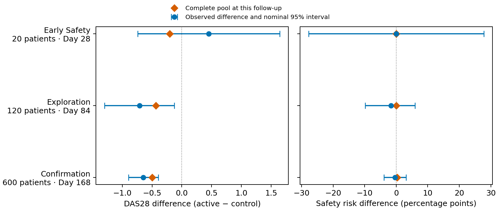
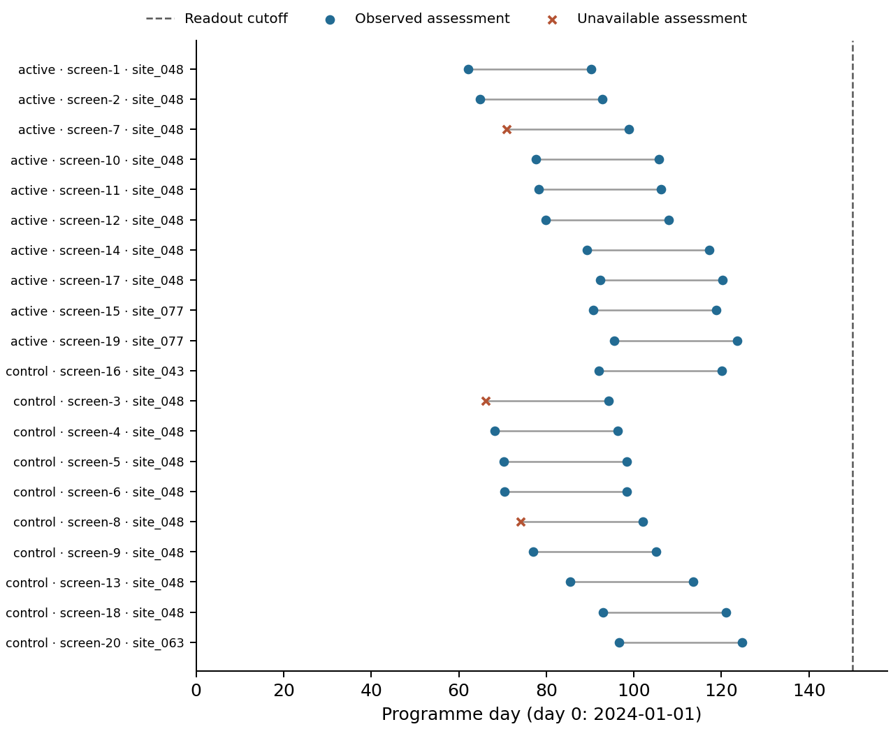

# Developing a rheumatoid-arthritis treatment

## Question and starting population

Which candidate warrants further development for adults with active rheumatoid arthritis despite treatment? The programme seeks lower DAS28 disease activity without an unacceptable increase in infection risk. It starts with 2,400 patients receiving standard care or one of 3 candidates.

## Table 1. Initial evidence

| Characteristic | Standard care | mrd-42525 | mrd-73360 | mrd-88030 |
| --- | ---: | ---: | ---: | ---: |
| Patients | 522 | 675 | 595 | 608 |
| Baseline DAS28, mean (SD) | 5.19 (0.94) | 5.48 (0.97) | 5.28 (0.95) | 4.70 (0.91) |
| Age, years, mean (SD) | 56.40 (11.73) | 55.44 (11.89) | 56.04 (12.14) | 55.46 (12.25) |
| Prior biologic treatment, n (%) | 187 (35.8) | 328 (48.6) | 232 (39.0) | 118 (19.4) |

A raw outcome difference mixes treatment-associated differences with differences in patient characteristics. This example fits separate outcome models by treatment, predicts each treatment for every baseline profile, and averages those predictions over the same population. This estimates the requested standardized association; it does not establish that all confounding has been removed.

## What the initial analysis changes

| Candidate | Raw DAS28 difference (95% interval) | Standardized difference (95% interval) |
| --- | ---: | ---: |
| mrd-42525 | 0.45 (0.27, 0.63) | 0.12 (-0.04, 0.27) |
| mrd-73360 | 0.09 (-0.09, 0.27) | -0.01 (-0.16, 0.15) |
| mrd-88030 | -1.03 (-1.20, -0.87) | -0.58 (-0.74, -0.42) |

Compare the raw and standardized differences to see how measured case mix affects the apparent benefit. Lower DAS28 favours the candidate; infection risk and the sponsor's stated preferences also affect whether development is worthwhile. The illustrative programme investigates mrd-88030 through three randomized studies.

## Authored studies and their readouts

The designs use a shared clinical question, 1:1 randomization and progressively longer follow-up. 20, 120 and 600 patients represent different precision and expenditure choices. Each confirmation arm holds 300 patients, the phase minimum, so one completed study can meet the regulator's exposure rule of 300 treated patients. For perspective, ten treated patients have a 65% chance of revealing at least one event with 10% risk, but only a 9.6% chance at 1% risk. An uneventful early study cannot exclude rare harm. Each activated site adds a fixed charge, so the smaller studies use fewer sites; the table records each study's site count.

| Phase | Sites | Randomized, active/control | Outcome observed, active/control | Infection events, active/control | Follow-up |
| --- | ---: | ---: | ---: | ---: | ---: |
| Early Safety | 6 | 10/10 | 10/10 | 0/0 | 28 days |
| Exploration | 20 | 60/60 | 57/57 | 1/2 | 84 days |
| Confirmation | 40 | 300/300 | 287/292 | 13/14 | 168 days |

DAS28 differences below use observed outcomes at each study's own horizon, with Welch intervals. Infection differences use all enrolled patients at the completed readout and Newcombe intervals. Phase-specific baseline summaries are in `trialdev_phase_baselines.csv`. The denominators show how many enrolled patients contributed an outcome.

| Phase | DAS28 difference (95% interval) | Infection risk difference, percentage points (95% interval) |
| --- | ---: | ---: |
| Early Safety | 0.45 (-0.74, 1.65) | 0.0 (-27.8, 27.8) |
| Exploration | -0.71 (-1.30, -0.12) | -1.7 (-9.8, 5.9) |
| Confirmation | -0.65 (-0.90, -0.40) | -0.3 (-3.8, 3.1) |



The intervals show how much each readout leaves unresolved. Compare both their width and their position relative to zero. Longer follow-up changes the clinical horizon as well as the amount of information: these are not three interchangeable estimates of one fixed effect.



The timeline includes all 20 early-safety participants; none is selected by outcome. Each grey segment runs from enrollment to the scheduled 28-day endpoint, not continuous observation. Circles are observed assessments and crosses unavailable assessments. The dashed line is the actual day-150 readout cutoff. Enrollment and follow-up use each participant's clock: day 150 is neither 150 days of individual follow-up nor an assessment at that time. Site labels identify recruitment membership. These teaching records have no reporting lag between occurrence and availability; they do not illustrate delayed transfer. Exact occurrence, availability and enrollment times are in [the timeline table](trialdev_participant_timeline.csv).

## Reproduce a submission from the visible records

In a fresh working directory, copy one disclosed `trialdev/readouts/<phase>-look` directory to `readout/`, create `scratch/`, and save the following as `scratch/analysis.py`. Run `python scratch/analysis.py` from that working directory. Running the same command in a second fresh Python session reproduces `scratch/estimates.csv`; no interactive variables, population potentials or reference tables are needed. Repeat with the next completed readout in its own working directory. The target identifiers and horizon come from that readout's `study.json`, rather than from a previous study.

This reproduces the two analyses in the table above for these completed, two-arm rheumatoid-arthritis teaching studies. It is an observed-outcome analysis, not a correction for informative missingness or incomplete safety ascertainment. The example uses the disclosed CSV projection; a live task supplies its own readout paths and file formats. Save and execute the corresponding analysis before requesting another readout or stopping, when the current results are captured. `check_analysis` can check fresh-session reproduction but cannot validate the clinical question or reveal the reference.

```python
import json
from pathlib import Path

import pandas as pd
from scipy.stats import ttest_ind
from statsmodels.stats.proportion import confint_proportions_2indep

readout = Path("readout")
study = json.loads((readout / "study.json").read_text())
targets = {row["endpoint"]: row for row in study["targets"]}
assert len(study["targets"]) == 2
assert set(targets) == {"clinical_outcome", "safety_risk"}
assert all(row["arm_id"] == "active" and row["confidence_level"] == 0.95
           for row in targets.values())
values, events, counts = {}, {}, {}
for arm in ("active", "control"):
    directory = readout / "arms" / arm
    baseline = pd.read_csv(directory / "baseline.csv", float_precision="round_trip")
    measurements = pd.read_csv(directory / "measurements.csv", float_precision="round_trip")
    safety = pd.read_csv(directory / "safety_events.csv")
    assert baseline.participant_id.is_unique
    enrollment = baseline.set_index("participant_id").enrollment_day
    assert set(measurements.participant_id) <= set(enrollment.index)
    assert set(safety.participant_id) <= set(enrollment.index)
    scheduled_time = measurements.participant_id.map(enrollment) + study["follow_up_days"]
    selected = measurements.loc[
        measurements.occurrence_time.eq(scheduled_time)
        & measurements.observed & measurements.outcome_id.eq("clinical_outcome")
    ]
    assert selected.participant_id.is_unique
    values[arm] = selected.observed_outcome.dropna()
    assert len(values[arm]) >= 2
    events[arm] = safety.participant_id.nunique()
    counts[arm] = len(baseline)

clinical = values["active"].mean() - values["control"].mean()
interval = ttest_ind(values["active"], values["control"], equal_var=False).confidence_interval()
lower, upper = confint_proportions_2indep(
    events["active"], counts["active"], events["control"], counts["control"],
    method="newcomb", alpha=0.05,
)
rows = [
    (targets["clinical_outcome"]["target_id"], clinical, interval.low, interval.high),
    (targets["safety_risk"]["target_id"],
     events["active"] / counts["active"] - events["control"] / counts["control"], lower, upper),
]
pd.DataFrame(rows, columns=["target_id", "estimate", "lower", "upper"]).to_csv(
    "scratch/estimates.csv", index=False
)
```

A CSV with only one row is a partial answer: the available target can be retained, but it does not yield a complete two-target loss. A later deliberate stop retains study and delay costs. Neither a reproducible CSV nor a permitted stop establishes that the analysis recovered the intended effect or that acquisition was worthwhile.

## Which records answer this question?

[Time and readout controls](trialdev_time_controls.csv) repeat the analysis using the scheduled visit, baseline substituted for follow-up, programme time mistaken for duration since enrollment, and the previous completed study where available. Each row retains its source study, target horizon and contributing counts. An empty extraction has no estimate or loss; it is not a zero effect.

Baseline and stale-readout estimates can reproduce exactly while answering a different question. Their Welch intervals quantify sampling variation in the selected records, not validity for the requested target. The correct visit can still be biased by missing outcomes. The three fixed teaching studies do not establish repeated-study coverage, clinical materiality or power. Previous-study comparisons also change participants and sometimes follow-up, so their differences do not isolate a clock effect. No method is required to have the smallest realised loss.

| Target study | Analysis records | Active/control observed | Difference (95% interval), DAS28 | Finite-target loss |
| --- | --- | ---: | ---: | ---: |
| early_safety | scheduled_visit (early_safety) | 10/10 | 0.453 (-0.740, 1.646) | 1.522 |
| early_safety | baseline_as_followup (early_safety) | 9/8 | 1.114 (0.118, 2.110) | 8.098 |
| early_safety | programme_clock_as_duration (early_safety) | 0/0 | No estimate | Not defined |
| exploration | scheduled_visit (exploration) | 57/57 | -0.710 (-1.296, -0.125) | 0.723 |
| exploration | baseline_as_followup (exploration) | 59/58 | -0.120 (-0.523, 0.282) | 0.560 |
| exploration | programme_clock_as_duration (exploration) | 0/0 | No estimate | Not defined |
| exploration | previous_study (early_safety) | 10/10 | 0.453 (-0.740, 1.646) | 1.637 |
| confirmation | scheduled_visit (confirmation) | 287/292 | -0.647 (-0.898, -0.395) | 0.326 |
| confirmation | baseline_as_followup (confirmation) | 296/296 | -0.076 (-0.245, 0.093) | 5.448 |
| confirmation | programme_clock_as_duration (confirmation) | 0/0 | No estimate | Not defined |
| confirmation | previous_study (exploration) | 57/57 | -0.710 (-1.296, -0.125) | 0.692 |

## Stop, continue or advance

A prespecified illustrative rule stops when observed benefit is nonpositive or the infection excess exceeds five percentage points. Another policy completes all three studies before choosing whether to advance from the observed estimates. Recruitment is matched through their shared studies. The table compares their decisions and costs with fixed advancement and immediate stopping. Neither observed-evidence policy consults complete outcomes.

| Policy | Decision | Net development value, USD |
| --- | --- | ---: |
| Stop before spending | stop | 0 |
| Fixed three-phase advance | advance | 653,418,593 |
| Same studies; plug-in terminal choice | advance | 653,418,593 |
| Observed-evidence stopping rule | stop | -3,903,600 |

An advanced treatment earns market value only if the regulator approves it. At submission on day 810, the regulator analysed the complete recorded outcomes of the 300 treated and 300 control confirmation patients whose follow-up had ended. Its pooled Welch statistic was z = 5.21; approval requires a two-sided 5% test of benefit and at least 300 completed treated patients, so the treatment was approved.

Approved value is annual profit of $250M per 1 DAS28-point benefit, less $20.83M per percentage point of excess infection risk. Both use Day-336 contrasts in the full programme population. Profit runs from launch, 365 days after submission, to exclusivity end on programme day 6,575, discounted at 10% a year to day zero, so each year of delay loses roughly 12% of the value. Study costs are nominal, and programme overhead accrues at $15,000 a day. The treatment contrasts average complete recorded outcomes over the same participants, retaining measurement variation, rounding and score limits before missed visits hide observations. Stopping avoids the treatment payoff while retaining incurred costs. Compare values within this programme: one example cannot establish which policy performs best across programmes with different benefits, harms and resource constraints.

The independent reader derives starting-cohort references by numerical integration, verifies matched recruitment, reproduces the observed-data decisions, repeats the regulator's approval test and recalculates costs and terminal value from the supplied records. The report, code and tables make the reasoning inspectable; numerical grading does not award credit for choosing these particular models or policies.
